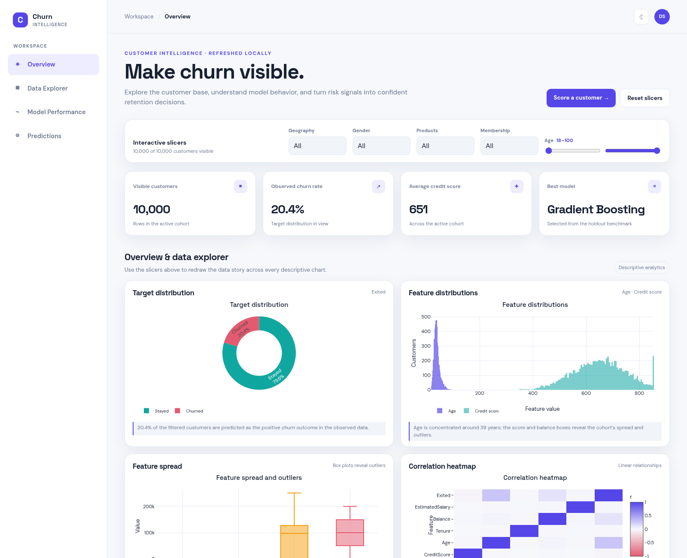
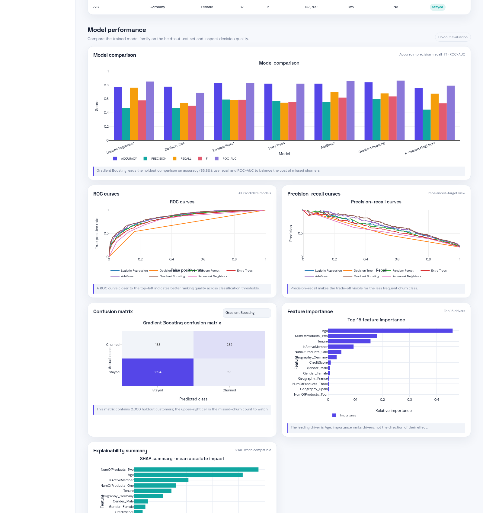
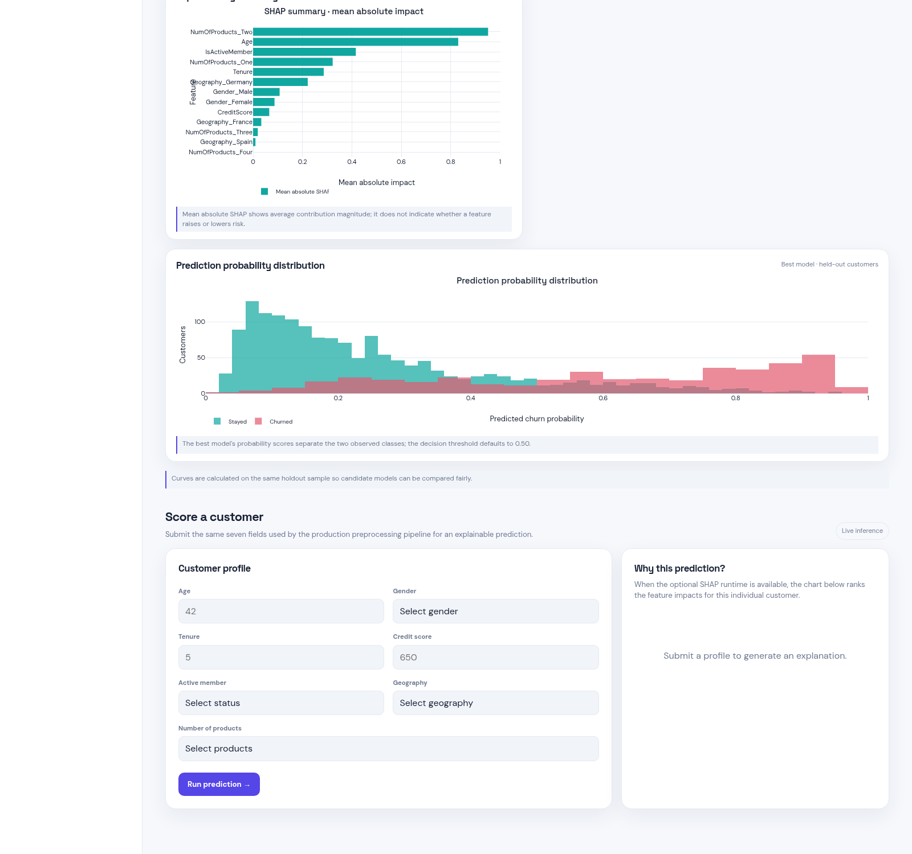

# Churn Intelligence Dashboard

An end-to-end customer churn analysis and prediction project for a bank customer
dataset. The project combines a scikit-learn training pipeline with a Flask web
application and a responsive, Power BI-style analytics workspace.

## What's New

### UI improvements

- A consistent responsive layout with sidebar navigation for **Overview**, **Data
  Explorer**, **Model Performance**, and **Predictions**.
- Light/dark theme toggle with the selection stored in the browser.
- KPI cards for the visible row count, observed churn rate, average credit score,
  and best holdout model.
- Power BI-style slicers for geography, gender, number of products, membership
  status, and age range. Descriptive charts and the drill-down table update
  together when a slicer changes.
- Loading, error, empty, mobile, and model-unavailable states.
- A searchable customer table with client-side CSV export.

### New analytics

- Target distribution donut.
- Feature histograms and box plots.
- Correlation heatmap.
- Categorical features compared with the churn target.
- Model comparison across accuracy, precision, recall, F1, and ROC-AUC.
- ROC and precision–recall curves for every candidate model.
- Selectable confusion matrices.
- Top-15 model feature importance.
- SHAP summary when the installed SHAP version supports the selected estimator,
  with a documented feature-importance fallback when it does not.
- Prediction probability distribution for the best holdout model.
- Live prediction form with optional per-customer SHAP explanation.

## Dashboard gallery

These screenshots are real browser captures of the local dashboard, not mockups.
They show the overview slicers, the model diagnostics, the confusion matrix, the
SHAP summary, and the prediction workspace.

### Overview and data explorer



### Model performance and explainability



### Probability distribution and prediction workspace



The dashboard is intentionally rendered from the live dataset and model
evaluation payload, so screenshots should be refreshed after changing the data
or model artifacts. The source metrics used for the README are also recorded in
[`docs/dashboard-metrics.json`](docs/dashboard-metrics.json).

## Features

- Modular ingestion, validation, transformation, SMOTE balancing, and training
  pipeline.
- Seven candidate classifiers evaluated on a held-out test split.
- Cached analytics payload exposed through `GET /api/dashboard`.
- JSON prediction endpoint at `POST /api/predict`.
- Backwards-compatible HTML prediction endpoint at `GET/POST /predict`.
- Cross-platform artifact paths using `pathlib`.
- SHAP-based explanations for model predictions when the optional plotting stack
  is available.

## Tech stack

- Python 3.10 or 3.11
- Flask and Gunicorn
- pandas, NumPy, scikit-learn, imbalanced-learn
- SHAP, Matplotlib, and Seaborn
- Plotly.js for browser-side interactive charts; the Python `plotly` package is
  included for reproducible analytics environments
- pytest for smoke and regression tests

## Setup

The checked-in model artifacts were produced with scikit-learn 1.5.2. Use a
Python 3.10 or 3.11 environment so the serialized model and preprocessor can be
loaded reliably.

```bash
python -m venv .venv
source .venv/bin/activate                 # Windows: .venv\Scripts\activate
python -m pip install --upgrade pip
python -m pip install -r requirements.txt
```

If the model artifacts have been removed or retrained with a different
scikit-learn version, run the training pipeline before making a live prediction:

```bash
python main.py
```

## Run locally

```bash
python app.py
```

Open <http://127.0.0.1:5000/>. The prediction-only page remains available at
<http://127.0.0.1:5000/predict>.

For a production WSGI process:

```bash
gunicorn --bind 0.0.0.0:5000 app:application
```

Set `FLASK_DEBUG=1` only for local debugging. The default application mode is
non-debug.

## Project structure

```text
.
├── app.py                         # Flask routes and prediction API
├── data/                          # Source customer churn CSV
├── artifacts/                     # Model, preprocessor, and split datasets
├── src/
│   ├── components/                # Ingestion, validation, transformation, training
│   ├── dashboard_service.py       # Cached dashboard analytics and model diagnostics
│   ├── pipeline/                  # Training and inference orchestration
│   └── utils.py                   # Serialization and metric helpers
├── static/
│   ├── css/dashboard.css          # Responsive theme and dashboard components
│   └── js/dashboard.js             # Plotly charts, slicers, table, and API calls
├── templates/
│   ├── base.html                   # Shared application shell
│   ├── index.html                  # Full analytics dashboard
│   └── home.html                   # Prediction-only view
├── experiments/                   # Exploratory notebooks
├── docs/
│   ├── dashboard-metrics.json     # Snapshot of the current evaluation metrics
│   └── screenshots/                # README dashboard gallery
├── requirements.txt
└── README.md
```

## Dataset

The application uses `data/credit-card-customer-churn.csv`, the public-style
bank customer churn dataset with 10,000 rows and the target column `Exited`:

- `Exited = 0`: customer stayed
- `Exited = 1`: customer exited
- Main model inputs: `CreditScore`, `Age`, `IsActiveMember`, `Tenure`, `Gender`,
  `Geography`, and `NumOfProducts`
- Additional explorer fields include balance, estimated salary, card ownership,
  and the original customer metadata columns
- The target is imbalanced, so SMOTE is applied to the training data in the
  existing transformation pipeline

The dashboard reads the source CSV for descriptive analytics and creates a
repeatable 80/20 holdout split with `random_state=1` for the model comparison.

## Model results

The values below are generated on application startup from the current source
dataset and holdout split; the dashboard is the source of truth because results
change when the data or artifacts change.

| Model | Accuracy | Precision | Recall | F1 | ROC-AUC |
| --- | ---: | ---: | ---: | ---: | ---: |
| Logistic Regression | 0.7695 | 0.4661 | 0.7614 | 0.5782 | 0.8502 |
| Decision Tree | 0.7765 | 0.4667 | 0.5398 | 0.5006 | 0.6891 |
| Random Forest | 0.8295 | 0.5907 | 0.5807 | 0.5857 | 0.8336 |
| Extra Trees | 0.8195 | 0.5678 | 0.5446 | 0.5560 | 0.8201 |
| AdaBoost | 0.8200 | 0.5522 | 0.7012 | 0.6178 | 0.8581 |
| Gradient Boosting | 0.8380 | 0.5962 | 0.6795 | 0.6351 | 0.8641 |
| K-nearest Neighbors | 0.7575 | 0.4444 | 0.6747 | 0.5359 | 0.7913 |

This avoids presenting stale notebook or README numbers as current evaluation
evidence. The selected production artifact remains in `artifacts/model.pkl`.

## Analytics snapshot

The current dashboard snapshot contains more than the five standard model
scores. These numbers are calculated from the 2,000-row holdout sample using
`random_state=1` and are included here so the README is useful without opening
the app:

| Data or diagnostic | Value |
| --- | ---: |
| Source rows | 10,000 |
| Observed churn rate | 20.37% |
| Holdout rows | 2,000 |
| Positive holdout rows | 415 |
| Best model | Gradient Boosting |
| Best-model average precision | 0.6924 |
| Best-model specificity | 0.8795 |
| Best-model confusion matrix | TN 1,394 · FP 191 · FN 133 · TP 282 |
| SHAP summary status | Available in the captured runtime |
| SHAP sample size | Up to 250 holdout rows |

### Top feature signals

Feature importance and SHAP answer slightly different questions. Feature
importance ranks the estimator's learned split/weight contribution, while the
SHAP values below show mean absolute contribution magnitude. Neither list alone
indicates whether a feature increases or decreases risk.

| Rank | Model feature importance | Value | Mean absolute SHAP feature | Value |
| ---: | --- | ---: | --- | ---: |
| 1 | Age | 0.4583 | NumOfProducts_Two | 0.9514 |
| 2 | NumOfProducts_Two | 0.1807 | Age | 0.8305 |
| 3 | Tenure | 0.1561 | IsActiveMember | 0.4159 |
| 4 | IsActiveMember | 0.0936 | NumOfProducts_One | 0.3222 |
| 5 | NumOfProducts_One | 0.0487 | Tenure | 0.2859 |

For the full top-15 lists and machine-readable values, see
[`docs/dashboard-metrics.json`](docs/dashboard-metrics.json). SHAP is optional:
if a runtime cannot explain the serialized estimator, the dashboard labels the
chart as a fallback importance summary instead of hiding the diagnostic.

## Deployment link

No hosted deployment is configured in this repository. Local deployment is:

- <http://127.0.0.1:5000/>
- Replace this section with the production URL after deploying the Gunicorn WSGI
  process.

## Future improvements

- Add a persisted evaluation artifact so model results can be reviewed without
  retraining the dashboard evaluation copies.
- Add a production Dockerfile and CI workflow with browser smoke tests.
- Add threshold tuning and cost-sensitive evaluation for retention campaigns.
- Add cohort comparison and time-based monitoring when a dated dataset is
  available.
- Add a server-side export endpoint for very large datasets.
